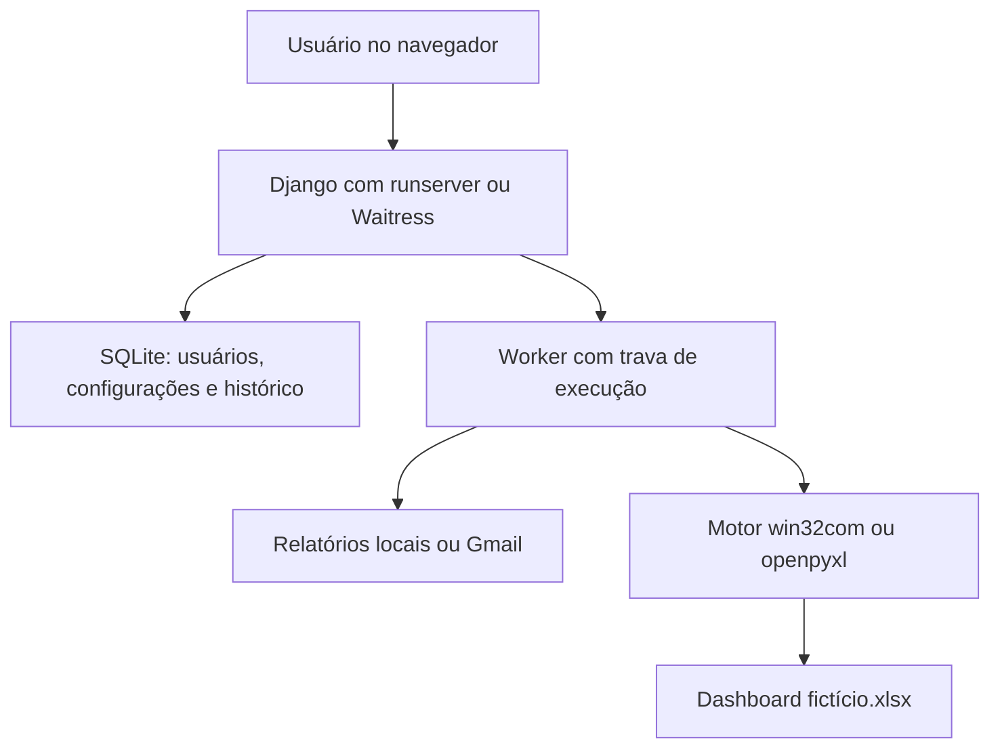

# Documentação técnica do projeto

## Automação de Dashboard com Python e Django

*Sistema de automação de relatórios para finalidades específicas, com dados de exemplo.*

| Identificação | Valor |
| --- | --- |
| Versão deste documento | 1.1 |
| Data da revisão | 13/11/2026 |
| Distribuição descrita | `automacao-dashboard-portfolio` |
| Ambiente de apresentação | Servidor local com dados fictícios |
| Motor principal | Excel COM por `win32com` |
| Motor alternativo | `openpyxl` |
| Publicação e licença | Não realizadas/definidas nesta preparação |

Este documento descreve a implementação presente no pacote de portfólio. O [README](../README.md) é o manual de instalação e operação para iniciantes. O arquivo [ALTERACOES_PORTFOLIO.md](ALTERACOES_PORTFOLIO.md) registra as decisões desta distribuição. A numeração identifica a revisão deste documento.

# 1. Contexto e objetivo

O projeto demonstra a consolidação de relatórios genéricos em um Dashboard Excel. Seu objetivo é ilustrar a obtenção de arquivos, a preparação e validação de dados, a atualização de planilhas e o acompanhamento por uma interface web.

O cenário é uma empresa fictícia, com relatórios de vendas, recebimentos, custos e despesas. Todos os clientes, fornecedores, equipes, códigos e valores dos modelos são sintéticos. A aplicação pode ser adaptada a finalidades específicas de outros processos, respeitando os contratos de entrada e as necessidades de cada projeto.

A distribuição funciona em servidor local. Uma implantação organizacional futura exige requisitos, configuração e validação próprios.

# 2. Escopo da versão demonstrativa

| Incluído | Situação |
| --- | --- |
| Quatro relatórios de origem e um Dashboard `.xlsx` | Modelos fictícios em `dados_demo` |
| Preparação e validação dos dados | pandas e regras de contrato por relatório |
| Atualização com Excel instalado | Implementação `win32com`, dependente de validação nativa no Windows |
| Atualização sem Excel | Implementação `openpyxl`, com fórmulas para recálculo posterior |
| Interface web | Login, permissões, progresso, histórico, download e administração |
| Recebimento de relatórios | Origem local ou Gmail pessoal opcional |
| Agendamento | Preferências e comando de verificação; não instala tarefa do sistema |
| Documentação operacional | README com instalação, configuração, servidores e logs |

Ficam fora desta distribuição: dados de empresas reais, credenciais de acesso, Dashboard `.xlsb`, macros, autenticação OAuth, outros provedores de e-mail, configuração de infraestrutura organizacional, alta disponibilidade e gerenciamento de múltiplos servidores.

# 3. Perfis de uso

| Perfil | Funções principais |
| --- | --- |
| Visitante | Acessar login, recuperação de senha e solicitação de cadastro |
| Usuário com cadastro pendente | Aguardar aprovação; conta criada sem ativação |
| Usuário autenticado comum | Consultar o painel e baixar o Dashboard; consultar progresso próprio quando permitido |
| Usuário com `is_staff=True` | Configurar caminhos, iniciar atualização, gerenciar cadastros e preferências de agendamento |
| Superusuário | Administração completa do Django e acesso às funções administrativas |

As views administrativas usam autenticação e checagem de `is_staff`. Os formulários de alteração usam POST e proteção CSRF. O cadastro público cria uma conta inativa, sem privilégios administrativos; a aprovação exige uma ação administrativa.

# 4. Requisitos funcionais

| Código | Requisito | Implementação |
| --- | --- | --- |
| RF01 | Preparar modelos e pastas de trabalho | `preparar_demo.py` |
| RF02 | Obter os quatro relatórios da origem selecionada | `FonteRelatorios` |
| RF03 | Preparar e validar os DataFrames | `preparar_dataframe` e contratos em `config.py` |
| RF04 | Ajustar área de registros e importar os dados | Motores COM e openpyxl |
| RF05 | Preservar P:U de RECEBIMENTOS | Importação dividida em dois blocos |
| RF06 | Atualizar totais, subtotais e resumo | Fórmulas geradas pelos motores |
| RF07 | Conferir os dados antes de salvar | Auditoria do motor selecionado |
| RF08 | Iniciar execução web sem bloquear a página até o término | View assíncrona e worker separado |
| RF09 | Registrar estado e progresso | `HistoricoExecucao` e callback do worker |
| RF10 | Disponibilizar download autenticado | `baixar_dashboard` |
| RF11 | Evitar escritas simultâneas no mesmo ambiente | Trava de processo |
| RF12 | Avaliar agendamento autorizado | Comando `executar_agendamento` |

# 5. Características técnicas e limites operacionais

A demonstração usa SQLite e arquivos locais em um único computador. Não há fila de tarefas distribuída. A trava coordena processos que usam o mesmo arquivo de bloqueio no mesmo ambiente; ela não é um mecanismo de coordenação entre máquinas independentes.

O motor COM cria uma instância própria do Excel e trabalha em cópia temporária. O motor openpyxl manipula o `.xlsx` diretamente em memória e exporta um arquivo temporário antes da substituição. As duas opções procuram preservar a versão anterior do Dashboard caso a execução falhe antes da confirmação da gravação.

As dependências têm faixas de versões em `requirements.txt`; não há um arquivo de lock que reproduza exatamente todas as dependências transitivas. O ambiente validado e os limites dos testes constam na seção 18.

# 6. Arquitetura



O navegador conversa com o servidor Django. A atualização assíncrona cria um registro e inicia `manage.py executar_atualizacao ID` em outro processo. Esse worker adquire a trava, define os caminhos, chama o executor e atualiza o registro no banco.

O executor seleciona o motor; o motor usa a origem de relatórios selecionada. As duas decisões são independentes. Ao executar o script pela CLI, há trava e log, mas não é criado o registro de histórico da interface.

## 6.1. Responsabilidades dos módulos

| Caminho | Responsabilidade |
| --- | --- |
| `projeto_web/settings.py` | Ambiente Django, banco, autenticação, arquivos estáticos e modo de teste |
| `projeto_web/urls.py` | Rotas HTTP |
| `projeto_web/wsgi.py` | Objeto WSGI servido pelo Waitress |
| `dashboard/models.py` | Configurações e histórico |
| `dashboard/views.py` | Interface, permissões, cadastro, disparo, progresso e download |
| `dashboard/bloqueio_execucao.py` | Trava usando `msvcrt` no Windows ou `fcntl` no Unix |
| `dashboard/management/commands/executar_atualizacao.py` | Worker manual com progresso e histórico |
| `dashboard/management/commands/executar_agendamento.py` | Avalia preferências e executa quando autorizado |
| `dashboard/management/commands/criar_admin_env.py` | Criação explícita do administrador com valores locais |
| `automacao/executar_automacao.py` | Entrada pública e seleção do motor |
| `automacao/config.py` | Contratos das quatro planilhas e raízes de trabalho |
| `automacao/fonte_relatorios.py` | Fonte local ou Gmail, validação e obtenção dos anexos |
| `automacao/verificar_gmail.py` | Verificação de autenticação sem atualizar o Dashboard |
| `automacao/motor_openpyxl.py` | Motor alternativo e funções de preparação/validação compartilhadas |
| `automacao/motor_win32com.py` | Motor principal com Excel COM e recálculo |
| `automacao/seguranca_demo.py` | Detecção de planilhas extras e diretórios redirecionados |
| `preparar_demo.py` | Cópia dos modelos para o ambiente de trabalho |

A reutilização de `preparar_dataframe` e `validar_caminhos` a partir do módulo openpyxl é uma decisão da implementação atual. Isso não significa que o motor COM escreva as células por openpyxl; ele usa o Excel para essa operação.

# 7. Configuração: três escolhas independentes

| Eixo | Valores | Efeito |
| --- | --- | --- |
| Ambiente | `AUTOMACAO_MODO_TESTE=1` | Usa `TESTE_AUTOMACAO` com caminhos fixos |
| Ambiente | `AUTOMACAO_MODO_TESTE=0` | Usa caminhos salvos no Django, restritos à árvore `DEMO_CONFIGURADA` |
| Motor | `AUTOMACAO_MOTOR=win32com` | Controla Excel desktop no Windows |
| Motor | `AUTOMACAO_MOTOR=openpyxl` | Atualiza o arquivo sem Excel instalado |
| Origem | `AUTOMACAO_ORIGEM=local` | Copia relatórios presentes na entrada |
| Origem | `AUTOMACAO_ORIGEM=gmail` | Autentica e baixa relatórios da conta pessoal configurada |

O padrão é teste ligado, motor win32com e origem local. Não há fallback automático de motor nem de origem. Uma falha de Gmail não autoriza reutilizar silenciosamente um lote local antigo.

`settings.py` carrega a `.env` da raiz sem sobrescrever variáveis já existentes no ambiente. O controle de teste é convertido pela comparação com o texto `"1"`. A interface e a CLI usam o valor de settings; chamadas programáticas do executor sem argumento explícito consultam a variável de ambiente.

Editar a linha de settings diretamente para `True` ou `False` faz essa opção deixar de depender da `.env`. Alterações de configuração exigem reiniciar o servidor. `DJANGO_DEBUG` é outra configuração e não escolhe o ambiente de automação.

Na CLI, os caminhos padrão vêm da raiz escolhida pelo modo, não do banco. Na interface, o modo configurado exige salvar os caminhos completos. Consulte o README para os comandos e exemplos de diretório.

## 7.1. Credenciais

| Grupo | Variáveis | Uso |
| --- | --- | --- |
| Gmail | `EMAIL_USUARIO`, `EMAIL_SENHA_APP` | Autenticar na origem Gmail, somente quando selecionada |
| Filtros do Gmail | `EMAIL_REMETENTE`, `EMAIL_ASSUNTO` | Selecionar a mensagem correta |
| Servidor IMAP | `EMAIL_IMAP_HOST`, `EMAIL_IMAP_PORT` | Adaptador restrito a `imap.gmail.com:993` |
| Administrador local | `DASHBOARD_ADMIN_USUARIO`, `DASHBOARD_ADMIN_EMAIL`, `DASHBOARD_ADMIN_SENHA` | Criar uma conta com `criar_admin_env` |
| Django | `DJANGO_SECRET_KEY` | Configuração de assinatura do Django |

A senha de app do Gmail é diferente da senha do Dashboard. O comando de criação valida a senha local com mínimo de 12 caracteres e os validadores do Django, não a exibe e não altera usuário já existente. Depois da criação, o login consulta o banco, não os campos de criação da `.env`.

A `.env` mantém os valores que o usuário escreveu em texto; a senha de login no banco é armazenada como hash pelo Django. O pacote fornece apenas `.env.example` sem senhas de acesso preenchidas.

# 8. Contratos dos arquivos

Todos os caminhos de modelo abaixo são relativos a `dados_demo`. As posições de destino referem-se a uma execução completa com os dados distribuídos.

| Origem | Registros | Colunas lidas | Linhas iniciais ignoradas | Seleção | Destino |
| --- | ---: | ---: | ---: | --- | --- |
| `vendas_exemplo.xlsx` | 6 | 22 | 3 | Todas | VENDAS, C8:X13 |
| `recebimentos_exemplo.xlsx` | 8 | 28 | 3 | A:O e V:AB | RECEBIMENTOS, A8:O15 e V8:AB15 |
| `custos_exemplo.xlsx` | 5 | 16 | 3 | Todas | CUSTOS, C8:R12 |
| `despesas_exemplo.xlsx` | 4 | 15 | 3 | A:L e N:O | DESPESAS, A8:N11 |

A linha TOTAL das fontes é removida pela preparação. O DataFrame deve permanecer não vazio, com identificadores não nulos/não duplicados e valores monetários numéricos e finitos. A coluna de identificador é convertida para texto. Os códigos fictícios que contêm zeros à esquerda são mantidos como texto nos modelos e na importação.

P:U de RECEBIMENTOS são reservadas. A importação escreve em dois blocos para preservar essas células. Nas novas linhas, o motor copia o padrão reservado da primeira linha. Esse comportamento não implementa associação de anotações manuais por chave quando a ordem dos registros muda.

O modelo inicial tem dois registros sintéticos por aba. A primeira atualização amplia as áreas de dados; executar novamente o mesmo lote substitui os registros, sem anexar cópias duplicadas. Uma redução de quantidade ajusta a área e as fórmulas.

# 9. Etapas de processamento

| Etapa | Operação |
| ---: | --- |
| 01 | Validar ambiente e preparar a origem; autenticar no Gmail se selecionado |
| 02 | Obter os quatro arquivos e preparar a pasta de processamento |
| 03 | Ler os relatórios com pandas |
| 04 | Selecionar colunas, remover TOTAL e preparar os DataFrames |
| 05 | Conferir os contratos de colunas e dados |
| 06 | Abrir o Dashboard pelo motor escolhido |
| 07 | Localizar TOTAL ou última linha de dados |
| 08 | Calcular contagens, diferenças e posições |
| 09 | Ajustar linhas e copiar formatação/padrões reservados |
| 10 | Limpar as áreas de importação |
| 11 | Escrever registros |
| 12 | Reconstruir TOTAL de VENDAS e RECEBIMENTOS |
| 13 | Atualizar fórmulas e resumo; executar auditoria |
| 14 | Salvar a cópia temporária |
| 15 | Fechar o workbook |
| 16 | Liberar o motor; encerrar a instância própria de Excel no COM |
| 17 | Encerrar a origem e a sessão IMAP, se utilizada |

No openpyxl, a substituição do destino ocorre durante a fase de salvamento. No COM, ela é confirmada após o fechamento do workbook e encerramento da instância. O progresso só é anunciado como 100% ao concluir a execução com sucesso.

## 9.1. Fórmulas e auditoria

As colunas monetárias recebem `SUBTOTAL` na linha 5. As abas com linha TOTAL usam `SUM` nessa linha. RESUMO recebe a quantidade de registros e o saldo de cada relatório.

No COM, o Excel recalcula as fórmulas com `CalculateFullRebuild`; a auditoria compara dados escritos, subtotais, totais e saldos calculados. No openpyxl, a auditoria compara os valores importados e as somas em Python; as fórmulas são gravadas com indicação de recálculo ao abrir o arquivo em um aplicativo de planilhas.

| Relatório | Saldo inicial do modelo | Saldo após importar o lote completo |
| --- | ---: | ---: |
| VENDAS | R$ 450,00 | R$ 6.300,00 |
| RECEBIMENTOS | R$ 450,00 | R$ 10.800,00 |
| CUSTOS | R$ 600,00 | R$ 6.000,00 |
| DESPESAS | R$ 900,00 | R$ 6.000,00 |

Esses saldos pertencem a relatórios diferentes e não devem ser somados como se representassem valores independentes de uma mesma carteira.

# 10. Origem Gmail

O adaptador usa IMAP sobre TLS, com conexão limitada por timeout de 30 segundos. O usuário deve ser uma conta pessoal `@gmail.com`, com senha de app válida. Não existe fluxo OAuth nesta versão.

A caixa INBOX é selecionada como somente leitura; o corpo é obtido com `BODY.PEEK[]`. O código não envia e-mails, não apaga mensagens e não solicita marcação como lida.

A pesquisa inicial usa o assunto configurado. Entre os 50 resultados de UID mais alto, o leitor verifica assunto exato e remetente. A primeira mensagem correspondente nessa ordem deve conter o conjunto completo dos quatro nomes esperados. Se estiver incompleta ou tiver anexos esperados duplicados, a execução é interrompida.

| Limite | Valor |
| --- | ---: |
| Mensagem recebida | 15 MiB |
| Cada anexo | 5 MiB |
| Tamanho descomprimido declarado do XLSX | 30 MiB |
| Resultados examinados | Até 50 |

O validador confere componentes mínimos do XLSX e recusa componentes identificados de VBA, conexões ou vínculos externos. Esses limites não equivalem a um antivírus ou a uma validação universal de documentos de terceiros. O uso previsto é enviar os quatro modelos fictícios fornecidos.

Os anexos completos são preparados em diretório temporário antes de substituir os arquivos conhecidos de entrada. A validação posterior dos dados ainda pode rejeitar o lote; nesse caso, o Dashboard não é atualizado. A instalação dos quatro anexos é feita arquivo a arquivo, não como uma transação única de lote.

# 11. Banco e persistência

| Modelo | Principais informações |
| --- | --- |
| `auth.User` | Usuário, senha com hash, estado ativo, staff e superusuário |
| `ConfiguracaoAutomacao` | Caminho do Dashboard, entrada, saída e data da alteração |
| `HistoricoExecucao` | Usuário, início, fim, estado, modo, origem, detalhe, progresso e etapa |
| `ConfiguracaoAgendamento` | Ativação, horário, dias da semana e liberação administrativa |

As configurações de automação e agendamento são utilizadas como registros únicos, normalmente com `pk=1`. O histórico é ordenado do mais recente para o mais antigo. O estado inicial de uma execução é `executando`; o término deve registrar `sucesso` ou `falha` e o horário final.

O SQLite é criado localmente pelas migrações. O pacote não distribui contas prontas nem banco de usuários pré-configurado.

# 12. Principais rotas

Os métodos abaixo descrevem o fluxo esperado das views. A autorização efetiva é aplicada pelo código, incluindo redirecionamentos de autenticação.

| Rota | Método do fluxo | Acesso e finalidade |
| --- | --- | --- |
| `/` | GET | Painel autenticado |
| `/login/` | GET/POST | Autenticar |
| `/logout/` | POST | Encerrar a sessão |
| `/cadastro/solicitar/` | GET/POST | Solicitar cadastro pendente |
| `/usuarios/novo/` | GET/POST | Staff cadastra usuário comum |
| `/usuarios/aprovacoes/` | GET/POST | Staff consulta/aprova/rejeita pendências |
| `/configurar/` | POST | Staff salva caminhos válidos |
| `/atualizar/iniciar/` | POST | Staff inicia worker; retorna identificação e URL de progresso |
| `/atualizar/progresso/<id>/` | GET | Staff ou usuário associado consulta progresso |
| `/atualizar/` | POST | Execução síncrona administrativa |
| `/dashboard/baixar/` | GET | Download autenticado do arquivo selecionado |
| `/agendamento/liberar/` | POST | Staff libera/bloqueia a configuração de agendamento |
| `/agendamento/configurar/` | POST | Staff salva preferências |
| `/senha/recuperar/` | GET/POST | Recuperação de senha pelo Django |
| `/senha/alterar/` | GET/POST | Troca de senha do usuário autenticado |
| `/admin/` | Conforme Django Admin | Administração do banco e das contas autorizadas |

O disparo assíncrono retorna HTTP 202 quando o processo é iniciado. A consulta de progresso devolve JSON com `id`, `status`, `progresso` e `etapa`. A execução síncrona retorna 200 no sucesso, 500 em falha de execução e 409 quando a trava está ocupada. Há também respostas de validação e autorização conforme a rota.

O botão principal usa o fluxo assíncrono. A rota síncrona permanece disponível, mas não recebe o mesmo callback de progresso do worker. O download cria uma cópia temporária independente enquanto segura a trava, evitando servir o arquivo durante sua atualização.

# 13. Execução e servidores

> **OPERAÇÃO:** use a raiz do projeto, após extrair o ZIP. Antes de alterar configurações, dependências ou arquivos de trabalho, aguarde a atualização terminar e pare o servidor. O README contém o passo a passo completo.

## 13.1. Preparação mínima no PowerShell

```powershell
py -m venv .venv
.\.venv\Scripts\python.exe -m pip install -r requirements.txt
Copy-Item .env.example .env
.\.venv\Scripts\python.exe preparar_demo.py
.\.venv\Scripts\python.exe manage.py migrate
```

Copie `.env.example` apenas se ainda não tiver uma `.env`. Em uma instalação existente, preserve os valores locais. Crie o usuário com `createsuperuser` ou preencha os campos locais e execute `criar_admin_env`, como descrito no README.

## 13.2. CLI e servidor web

A CLI independe de um servidor web:

```powershell
.\.venv\Scripts\python.exe automacao\executar_automacao.py --motor openpyxl
```

Para COM, substitua o valor do motor por `win32com` no Windows com Excel instalado. A origem dos relatórios é lida da configuração.

> **ANTES DE LIGAR:** escolha uma opção e confira se não há outro servidor desta demonstração aberto. Para parar, aguarde a automação terminar e use `Ctrl+C` no terminal correto.

```powershell
.\.venv\Scripts\python.exe manage.py runserver 127.0.0.1:8000
```

Waitress é uma alternativa WSGI. Prepare os arquivos estáticos e inicie separadamente, com o runserver parado:

> **ANTES DE LIGAR WAITRESS:** aguarde qualquer atualização terminar e pare o servidor anterior. Após mudar `.env` ou código, pare e reinicie o Waitress.

```powershell
.\.venv\Scripts\python.exe manage.py collectstatic --noinput
.\.venv\Scripts\python.exe -m waitress --listen=127.0.0.1:8080 --threads=1 projeto_web.wsgi:application
```

Acesso local: porta 8000 para o exemplo de runserver, ou 8080 para Waitress. A configuração de produção, HTTPS, proxy e serviço do sistema não é implementada por esses comandos. Fechar a aba do navegador não desliga o servidor. Parar o servidor também não garante encerrar um worker já iniciado.

# 14. Agendamento

`ConfiguracaoAgendamento` mantém a liberação administrativa separada da ativação. `executar_agendamento` verifica dia da semana, minuto configurado, modo de teste, configurações e existência de registro agendado na mesma data.

Com modo teste ativo, a execução agendada é bloqueada. No modo configurado, ela usa os caminhos salvos e o executor comum. O comando precisa ser chamado por um mecanismo externo, como uma tarefa do sistema operacional; a aplicação não instala essa tarefa automaticamente e não mantém um scheduler interno contínuo.

A regra atual considera qualquer registro agendado daquela data para impedir repetição, inclusive quando a tentativa anterior falhou. Retentativas no mesmo dia e comportamento após falhas devem ser definidos antes de um uso contínuo. O fuso configurado no Django é utilizado na avaliação do horário.

# 15. Logs, diagnóstico e recuperação

| Evidência | Local |
| --- | --- |
| Log do motor | `logs/automacao.log` |
| Saída do worker assíncrono | `diagnostico_atualizacao.log` |
| Saída do servidor | Terminal de runserver/Waitress |
| Registro de execução web | SQLite e tabela de histórico na página |

Os arquivos são acrescentados ao final e não têm rotação automática nesta versão. O log principal é criado quando o executor configura logging. A ausência dele antes da primeira execução é esperada. Uma falha anterior ao carregamento do motor pode aparecer apenas no terminal ou no diagnóstico do worker.

Para ler as últimas linhas em outro terminal, na raiz:

```powershell
Get-Content .\logs\automacao.log -Tail 50
Get-Content .\diagnostico_atualizacao.log -Tail 50
```

Ao usar `Get-Content -Wait`, `Ctrl+C` naquele terminal interrompe apenas a leitura do arquivo. Para desligar o servidor, use o terminal que o iniciou.

## 15.1. Recuperação orientada pela falha

| Problema | Procedimento |
| --- | --- |
| Mensagem Gmail ausente/incompleta | Conferir assunto/remetente; enviar novo lote completo e tentar novamente |
| Falha de autenticação | Conferir senha de app local; testar `verificar_gmail` |
| Planilhas extras | Mover arquivos antigos para fora do ambiente; não renomear dados reais para nomes de teste |
| Falha ao salvar | Fechar o Dashboard em aplicativos externos e analisar a exceção registrada |
| Histórico preso em `executando` | Confirmar que o processo realmente terminou antes de corrigir o registro pelo Admin |
| Modelos de trabalho alterados | Parar processos e usar `preparar_demo.py --restaurar` para o ambiente correto |
| Configuração alterada sem efeito | Conferir precedência de variável no terminal e reiniciar o servidor |

Interrupção forçada pode deixar histórico incompleto ou temporários. O arquivo de trava não deve ser removido enquanto há uma execução em andamento; o bloqueio é do processo, não simplesmente a existência do arquivo.

Para preservar estado antes de manutenção, aguarde o término da automação, pare o servidor e faça cópias do banco local e das pastas de trabalho relevantes. A `.env` contém segredos e deve ser guardada separadamente. Restaurar os modelos não restaura o banco nem o histórico.

# 16. Controles implementados e alcance

| Controle | Alcance |
| --- | --- |
| Autenticação, staff e CSRF | Acesso e ações pela interface |
| Validação de caminho e links simbólicos | Restringe os destinos às árvores demonstrativas previstas |
| Lista de nomes conhecidos e detecção de planilhas extras | Evita misturar arquivos de outras versões nas pastas de trabalho |
| Trava de processo | Evita escrita concorrente entre processos cooperantes do mesmo ambiente |
| Excel em instância própria | Não reutiliza janelas pessoais abertas pelo usuário |
| Cópia temporária antes da confirmação | Reduz o risco de modificar o Dashboard anterior em falhas de processamento |
| IMAP somente leitura e `BODY.PEEK[]` | Não solicita alteração de mensagens ou marcação de leitura |
| Credenciais fora dos arquivos públicos | Modelo sem senhas e `.env` ignorada pelo Git |

Esses controles não identificam automaticamente se o conteúdo de uma planilha pertence a uma empresa real ou é sintético. Uma pessoa pode renomear um arquivo real; por isso, o procedimento operacional exige usar os modelos sintéticos distribuídos.

O modo de implantação do Django possui algumas verificações de configuração, mas não instala proxy, certificados, contas de serviço ou infraestrutura. Sua existência não é evidência de uma revisão completa de segurança.

# 17. Preparação para servidor organizacional

A implantação organizacional deve ser tratada como outra etapa de engenharia, com requisitos e aceite próprios. Pontos a definir com a equipe responsável:

- Servidor, conta de execução e permissões sobre arquivos, banco e credenciais.
- Validação do Excel COM na sessão e no modo de execução pretendidos.
- Estratégia de dados, e-mail e autenticação do ambiente organizacional.
- Servidor web, arquivos estáticos, HTTPS e encaminhamento por proxy conforme a infraestrutura.
- Backup, retenção/rotação de logs, recuperação de execuções interrompidas e suporte operacional.
- Testes de concorrência, carga, falhas e conferência dos resultados com as fontes autorizadas.

O uso de Docker Windows não garante que Excel COM funcione no contêiner. A viabilidade precisa ser verificada no ambiente de destino. Esta distribuição não fornece uma imagem de contêiner homologada nem substitui a documentação de implantação.

# 18. Testes e evidências

A revisão de 13/11/2026 atualiza os nomes, os campos e os contratos dos relatórios de exemplo. A suíte contempla 96 testes, incluindo a coerência dos valores comerciais e os fluxos de importação. O resultado foi de 95 testes aprovados e 1 teste nativo de Excel ignorado, pois exige Windows e ativação explícita. Seu resultado não é substituído pelos testes do motor portável.

| Grupo | Cobertura registrada |
| --- | --- |
| Motor portável | Importação real das planilhas fictícias, repetição, redução, P:U, texto e falhas |
| Django | Autenticação, permissões, cadastros, histórico, progresso, configuração e download |
| Seleção de motor/COM | Escolha explícita e falhas/limpeza de recursos com mocks |
| Gmail | 11 testes offline com mensagens sintéticas e servidor simulado |
| Administrador pela `.env` | 4 testes de criação, validação e preservação de conta existente |
| Servidores locais | Inicialização, resposta de login e CSS conferidos com runserver e Waitress no Linux |
| Migrações | Nenhuma alteração de modelo pendente na conferência registrada |

Ambiente usado: Linux, Python 3.12.14, Django 5.2.19, pandas 2.2.3 e openpyxl 3.1.5. As dependências podem resolver versões diferentes dentro das faixas do requirements.

Não foi realizada autenticação em Gmail real, execução nativa do Excel no Windows nem homologação de servidor organizacional. Os testes do resumo e das fórmulas não comprovam comportamento de macros ou de formatos não implementados.

## 18.1. Reexecutar a suíte

> **ANTES DOS TESTES:** aguarde a automação terminar, pare o servidor e use a raiz do projeto e o ambiente virtual correto. Leia o resultado final da suíte; falhas provocadas pelos testes também geram mensagens nos logs.

```powershell
.\.venv\Scripts\python.exe manage.py check
.\.venv\Scripts\python.exe manage.py test -v 1
.\.venv\Scripts\python.exe manage.py makemigrations --check --dry-run
```

O teste nativo de Excel exige Windows, Excel desktop e `EXECUTAR_TESTE_EXCEL=1`. O README contém o comando e a orientação para remover essa variável após o teste. Não conte um teste ignorado como integração nativa aprovada.

# 19. Limitações e decisões pendentes

1. Validar Gmail e Excel reais no computador de apresentação.
2. Homologar infraestrutura e execução organizacional separadamente.
3. Definir política de retentativa e recuperação de registros interrompidos.
4. Implementar rotação de logs e gestão de segredos apropriadas ao ambiente de implantação.
5. Avaliar OAuth e outros provedores caso sejam requisitos futuros.
6. Definir processo de release, versões fixadas e automação de testes conforme a evolução do projeto.
7. Definir a política de publicação e licença antes de apresentar o código como open source.

# 20. Publicação e licenciamento

**Não foi adicionada uma licença aberta ao pacote. Nenhum push ou criação de repositório remoto foi realizado nesta preparação.** Esta documentação não concede permissões de uso nem determina a titularidade do código.

Repositório público significa visibilidade; open source envolve também termos que permitam uso, modificação e redistribuição. No GitHub, a visibilidade pública ainda tem os efeitos previstos nos termos da plataforma, incluindo visualização e fork; isso não substitui a escolha de uma licença aberta.

A escolha de licença é uma decisão separada da criação dos exemplos. Esta revisão documental não adiciona permissões nem altera direitos sobre o código.

Referências: [Definição Open Source da OSI](https://opensource.org/osd) e [Licenciamento de repositórios no GitHub](https://docs.github.com/en/repositories/managing-your-repositorys-settings-and-features/customizing-your-repository/licensing-a-repository). A situação jurídica concreta não foi determinada por esta documentação.

# 21. Referências da implementação

- [README e guia operacional](../README.md)
- [Registro das adaptações](ALTERACOES_PORTFOLIO.md)
- [Configuração e contrato das planilhas](../automacao/config.py)
- [Entrada do executor](../automacao/executar_automacao.py)
- [Modelos do Django](../dashboard/models.py)
- [Rotas do projeto](../projeto_web/urls.py)
- [Documentação Django 5.2](https://docs.djangoproject.com/en/5.2/)
- [Waitress](https://docs.pylonsproject.org/projects/waitress/en/latest/)
- [pywin32](https://github.com/mhammond/pywin32)
- [pandas](https://pandas.pydata.org/docs/)
- [openpyxl](https://openpyxl.readthedocs.io/en/stable/)

# 22. Glossário

| Termo | Significado neste projeto |
| --- | --- |
| Raiz | Pasta de `manage.py`, `requirements.txt` e `README.md` |
| Ambiente virtual | Conjunto isolado de Python e dependências em `.venv` |
| DataFrame | Estrutura tabular do pandas usada para preparar os relatórios |
| COM | Interface usada pelo Python para controlar o Excel no Windows |
| WSGI | Interface entre um servidor como Waitress e a aplicação Python |
| Worker | Processo separado que executa a atualização solicitada pela interface |
| Callback | Função chamada pelo motor para registrar o andamento |
| IMAP | Protocolo usado para ler as mensagens da conta configurada |
| TLS | Proteção da conexão de rede usada na leitura do Gmail |
| Log | Registro de acontecimentos e erros do programa |
| Migração | Alteração versionada da estrutura de banco gerenciada pelo Django |
| Homologação | Validação com critérios de aceite no ambiente em que a solução será utilizada |
